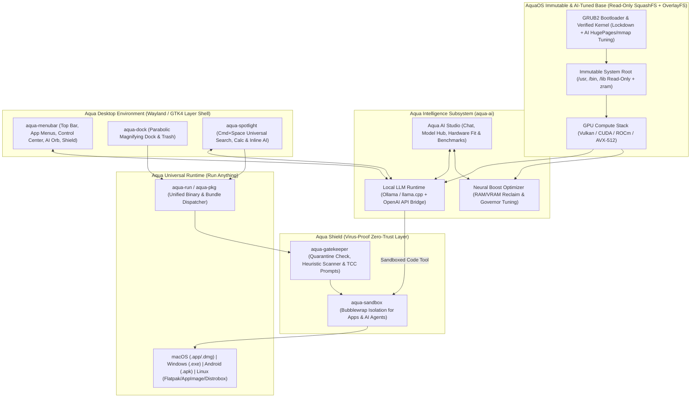

# AquaOS-Beta Implementation Plan

## Goal Description

Build **AquaOS-Beta** in `C:/Users/iamni/Desktop/AquaOS-Beta`: an independent, virus-proof, AI-first bootable Linux distribution featuring a custom-built macOS-inspired desktop environment (**Aqua Desktop**), a **Universal Application Runtime (`aqua-universal`)**, a **Zero-Trust Security Engine (`aqua-shield`)**, and a deeply integrated **Local AI & Neural Compute Stack (`aqua-ai`)**.

The architecture consists of five cohesive pillars:

1. **Aqua Intelligence & AI-Optimized OS Core (`aqua-ai` — "Best for Running AI")**:
   - **AI Kernel & Memory Tuning (`98-aquaos-ai-tuning.conf`)**: Pre-tuned Linux kernel parameters for LLM & tensor workloads—`vm.max_map_count=2147483642` (for zero-copy `mmap` loading of massive GGUF/Safetensors weights), Transparent HugePages (`madvise`), unlimited `memlock` for GPU VRAM pinning, and `zram` compressed swap to run larger quantized models without Out-Of-Memory crashes.
   - **Universal GPU/NPU Compute Layer**: Built-in hardware acceleration orchestrator supporting **Vulkan (`llama.cpp` universal GPU backend)** out of the box, plus one-click driver/runtime activation for **NVIDIA CUDA/TensorRT**, **AMD ROCm**, and **Intel OpenVINO/SYCL**.
   - **Neural Boost Mode**: A toggle in the **Control Center** and **Menu Bar** that switches the CPU/GPU governor to `performance`, flushes reclaimable OS pagecache to maximize free VRAM/RAM for model weights, and elevates LLM inference priority.
   - **Native Local AI Engine (`Ollama` + `llama.cpp` + OpenAI-Compatible API)**:
     - Runs 100% private offline models (`DeepSeek-R1`, `Qwen 2.5 Coder`, `Llama 3.3`, `Gemma 3`, `Mistral`) as well as optional cloud APIs (Gemini, OpenAI, Anthropic).
     - **Apple Intelligence-Style OS Integration**: Ask AI directly from **Spotlight (`Super+Space`)**, the **Top Menu Bar AI Orb**, or **Aqua AI Studio** to generate code, summarize local files, or execute OS actions.
     - **Sandboxed AI Code Execution**: When an AI agent runs Python or shell scripts, it executes inside **`aqua-sandbox`** (`Bubblewrap`) so autonomous AI agents can safely run code without risking the host OS.
2. **Aqua Desktop Environment (`aqua-desktop`)**: Built from scratch in Python 3 + GTK4 + `gtk4-layer-shell` + Wayland (`labwc` / `wlroots` compositor with `picom`/X11 fallback).
   - **Top Global Menu Bar (`aqua-menubar`)** with the Aqua menu, active app title & global menus, **Aqua Intelligence Orb**, **Aqua Shield badge**, and **Control Center** popover.
   - **Magnifying Application Dock (`aqua-dock`)** with smooth parabolic hover magnification, pinned & running application tracking, launch bounce animations, active dot indicators, and Trash integration.
   - **Spotlight Search (`aqua-spotlight`)** (`Super+Space`) for instant fuzzy app launching, universal file search, inline math calculator, and **instant `@ai` natural-language queries**.
   - **Window Management & Aqua Aesthetics (`aqua-wm` & `aqua-theme`)** with top-left red/yellow/green traffic-light window controls, frosted glass blur, rounded corners, and built-in **Aqua AI Studio**, **Aqua Shield Security Center**, **About AquaOS**, and **System Settings**.
3. **Universal Application Subsystem (`aqua-universal` — "Run Anything")**:
   - Unified launcher (`aqua-run`) and package manager (`aqua-pkg`) that transparently runs:
     - **macOS Apps (`.app`, `.dmg`)** via **Darling** & native AquaOS `.app` bundles.
     - **Windows Apps & Games (`.exe`, `.msi`)** via **Wine / Proton** inside isolated prefixes.
     - **Android Apps (`.apk`)** via **Waydroid**.
     - **Linux Universal Formats (`.AppImage`, `Flatpak`, `.deb`, `.rpm`, `.pkg.tar.zst`)** natively or via rootless **Distrobox / Podman** containers.
4. **Virus-Proof Zero-Trust Security Engine (`aqua-shield`)**:
   - **Immutable Read-Only Core OS** (`SquashFS` + `OverlayFS` verification) so malware cannot modify system binaries or survive a clean reboot.
   - **Mandatory Application Sandboxing (`aqua-sandbox`)** using **Bubblewrap (`bwrap`)**, **AppArmor**, and **Seccomp-BPF**.
   - **macOS Gatekeeper & TCC Permission Prompts (`aqua-gatekeeper`)** with static/heuristic malware scanning and per-folder/network consent dialogs.
   - **Kernel Hardening & Zero-Trust Firewall** (`sysctl` lockdown + `nftables`).
5. **Automated Bootable ISO Build Pipeline (`iso-builder`)**: A reproducible Docker / WSL2 build system producing a hybrid BIOS/UEFI bootable `aquaos-1.0-amd64.iso` with one-click QEMU testing on Windows.

---

## System Architecture

---

## Proposed Changes

All files below will be created under [C:/Users/iamni/Desktop/AquaOS-Beta](file:///C:/Users/iamni/Desktop/AquaOS-Beta).

### 1. Project Structure & Shared IPC Core (`aqua-desktop/core`)

#### [NEW] [config.py](file:///C:/Users/iamni/Desktop/AquaOS-Beta/aqua-desktop/core/config.py)
- Manages user preferences in `~/.config/aquaos/settings.json` (theme mode, accent color, dock settings, security policy, and AI configuration: default local model, Ollama endpoint, Neural Boost state, and sandboxed code execution toggle).

#### [NEW] [app_indexer.py](file:///C:/Users/iamni/Desktop/AquaOS-Beta/aqua-desktop/core/app_indexer.py)
- Indexes standard `.desktop` apps, macOS-style `/Applications/*.app` bundles, Flatpaks, AppImages, and Windows shortcuts.

#### [NEW] [window_tracker.py](file:///C:/Users/iamni/Desktop/AquaOS-Beta/aqua-desktop/core/window_tracker.py)
- Tracks open windows, active application title, PID/sandbox status, and window actions across Wayland and X11.

#### [NEW] [system_services.py](file:///C:/Users/iamni/Desktop/AquaOS-Beta/aqua-desktop/core/system_services.py)
- Interfaces with audio (`wpctl`/`pactl`), brightness, network (`nmcli`), battery (`upower`), CPU/RAM/GPU VRAM telemetry (`nvidia-smi`, `/sys/class/drm`, `/proc/meminfo`), and Neural Boost memory reclamation.

---

### 2. Aqua Intelligence & Local AI Subsystem (`aqua-desktop/ai`)

#### [NEW] [ai_engine.py](file:///C:/Users/iamni/Desktop/AquaOS-Beta/aqua-desktop/ai/ai_engine.py)
- Unified AI client & model manager supporting:
  - **Local Ollama / `llama.cpp` server** (`http://127.0.0.1:11434` / `http://127.0.0.1:8080`) with zero external dependencies.
  - **Hardware Compatibility & Model Fit Estimator**: Detects total system RAM, available RAM, GPU vendor (NVIDIA/AMD/Intel/Apple/VirtIO), and VRAM, recommending optimal quantization levels (`Q4_K_M`, `Q5_K_M`, `Q8_0`, `FP16`) for models (`DeepSeek-R1 1.5B/7B/14B/32B`, `Qwen 2.5 Coder`, `Llama 3.3`, `Gemma 3`).
  - **Sandboxed Code Interpreter**: Executes AI-generated Python/Bash snippets inside `aqua-sandbox` (`Bubblewrap`) so AI agents can solve math, analyze data, or automate tasks with zero risk to user files.
  - **Natural Language OS Actions**: Parses intents like turning on Dark Mode, enabling Neural Boost, scanning a folder, or launching apps.

#### [NEW] [neural_boost.py](file:///C:/Users/iamni/Desktop/AquaOS-Beta/aqua-desktop/ai/neural_boost.py)
- Implements **Neural Boost Mode** (`aqua-neural-boost`):
  - Frees OS pagecache/dentries/inodes (`sync && sysctl vm.drop_caches=3` when privileged) to maximize contiguous RAM for LLM loading.
  - Switches CPU scaling governor to `performance` and sets GPU power profile.
  - Configures environment variables (`OLLAMA_FLASH_ATTENTION=1`, `OLLAMA_KV_CACHE_TYPE=q8_0`, `GGML_VK_VISIBLE_DEVICES=0`) so models use Flash Attention and quantized KV cache to fit 2x longer context windows in memory.

#### [NEW] [ai_studio.py](file:///C:/Users/iamni/Desktop/AquaOS-Beta/aqua-desktop/ai/ai_studio.py)
- Native GTK4 **Aqua AI Studio** desktop application featuring:
  - **Assistant Chat Tab**: Streaming chat interface with model selector, system prompt presets (*Coding Assistant*, *Linux SysAdmin*, *Security Analyst*, *Creative Writer*), and one-click *"Run in Sandbox"* for code blocks.
  - **Model Hub & Hardware Fit Tab**: Shows detected CPU/RAM/GPU hardware badges, lists curated local LLM models with live *"Fits in VRAM / RAM"* badges, one-click Download (`ollama pull`), and an integrated **Inference Speed Benchmark (`tokens/sec`)**.
  - **Neural Compute & Containers Tab**: Toggle Neural Boost, Flash Attention, KV Cache quantization (`FP16` / `Q8_0` / `Q4_0`), and launch one-click AI workspaces (JupyterLab / PyTorch, ComfyUI, Open WebUI).

#### [NEW] [98-aquaos-ai-tuning.conf](file:///C:/Users/iamni/Desktop/AquaOS-Beta/iso-builder/security/98-aquaos-ai-tuning.conf)
- Kernel `sysctl` tuning specifically engineered for local LLM inference & PyTorch training:
  - `vm.max_map_count = 2147483642` (prevents `mmap` allocation failures on large multi-tensor models)
  - `vm.swappiness = 10` (keeps model weights pinned in physical RAM instead of swapping prematurely)
  - `vm.overcommit_memory = 1` (allows PyTorch/CUDA tensor allocators to reserve virtual address spaces cleanly)
  - `kernel.sched_autogroup_enabled = 1` (keeps the Aqua desktop UI silky-smooth at 60+ FPS even when CPU/GPU is at 100% running LLM inference).

---

### 3. Virus-Proof Zero-Trust Security Engine (`aqua-desktop/security`)

#### [NEW] [gatekeeper.py](file:///C:/Users/iamni/Desktop/AquaOS-Beta/aqua-desktop/security/gatekeeper.py)
- Implements **Aqua Gatekeeper & Static/Heuristic Malware Scanner**:
  - Checks quarantine attributes (`user.aquaos.quarantine`) and SHA-256 trust database.
  - Performs static & heuristic analysis on ELF, PE (`.exe`/`.dll`), Mach-O (`.app`), and scripts (detecting shell injection patterns, crypto-miner signatures, `LD_PRELOAD` hijacking, and high-entropy packed sections).
  - Launches a GTK4 **macOS Gatekeeper & TCC Permission Prompt** (*Run in Sandbox*, *Configure Folder/Network Access*, *Block*).

#### [NEW] [sandbox.py](file:///C:/Users/iamni/Desktop/AquaOS-Beta/aqua-desktop/security/sandbox.py)
- Implements **Aqua Sandbox (`aqua-sandbox`)** using `bwrap` (Bubblewrap) / `firejail`:
  - Mounts `/usr`, `/lib`, `/bin`, `/sbin` strictly read-only (`--ro-bind`).
  - Creates an isolated per-app private `$HOME` (`~/.local/share/aqua-sandboxes/<app-id>`) blocking access to `~/.ssh`, `~/.gnupg`, and personal files unless permitted via TCC.

#### [NEW] [shield_center.py](file:///C:/Users/iamni/Desktop/AquaOS-Beta/aqua-desktop/security/shield_center.py)
- GTK4 **Aqua Shield Security Center** app showing Immutable RootFS status, Kernel Hardening score, Active Sandboxes, Firewall controls, and On-Demand Malware Scanner.

#### [NEW] [99-aquaos-hardening.conf](file:///C:/Users/iamni/Desktop/AquaOS-Beta/iso-builder/security/99-aquaos-hardening.conf) & [nftables.conf](file:///C:/Users/iamni/Desktop/AquaOS-Beta/iso-builder/security/nftables.conf)
- Kernel hardening parameters and zero-trust default-deny `nftables` firewall.

---

### 4. Universal Application Runtime (`aqua-desktop/universal`)

#### [NEW] [aqua_run.py](file:///C:/Users/iamni/Desktop/AquaOS-Beta/aqua-desktop/universal/aqua_run.py) & [aqua_pkg.py](file:///C:/Users/iamni/Desktop/AquaOS-Beta/aqua-desktop/universal/aqua_pkg.py)
- Universal binary & bundle execution engine (`aqua-run`) and package manager (`aqua-pkg`) supporting `.app`, `.dmg`, `.exe`, `.msi`, `.AppImage`, `Flatpak`, `.apk`, `.deb`, `.rpm`, and `.pkg.tar.zst` (via Distrobox).

---

### 5. Global Menu Bar, Dock, Spotlight & Native Apps (`aqua-desktop/`)

#### [NEW] [menubar.py](file:///C:/Users/iamni/Desktop/AquaOS-Beta/aqua-desktop/menubar/menubar.py) & [control_center.py](file:///C:/Users/iamni/Desktop/AquaOS-Beta/aqua-desktop/menubar/control_center.py)
- 28px top Global Menu Bar with Aqua menu, active app menus, **Aqua Intelligence Orb** (one-click AI assistant), **Aqua Shield status icon**, Wi-Fi, battery, clock/calendar, and Control Center popover (with **Neural Boost** quick toggle).

#### [NEW] [dock.py](file:///C:/Users/iamni/Desktop/AquaOS-Beta/aqua-desktop/dock/dock.py)
- Bottom frosted-glass Dock with parabolic hover magnification, **Aqua AI Studio** & **Aqua Shield** pinned alongside Finder, Browser, Terminal, and Settings, plus running indicators and Trash.

#### [NEW] [spotlight.py](file:///C:/Users/iamni/Desktop/AquaOS-Beta/aqua-desktop/spotlight/spotlight.py)
- `Super+Space` global search for native apps, `.app` bundles, Windows `.exe` apps, files, inline math calculator, and **instant `@ai` Apple Intelligence-style queries**.

#### [NEW] [about_aquaos.py](file:///C:/Users/iamni/Desktop/AquaOS-Beta/aqua-desktop/apps/about_aquaos.py) & [system_settings.py](file:///C:/Users/iamni/Desktop/AquaOS-Beta/aqua-desktop/apps/system_settings.py)
- "About AquaOS" hardware/AI/OS dialog and macOS-style System Settings (Appearance, Dock, Wallpaper, AI & Neural Engine, Security & Privacy).

---

### 6. Window Manager, Session & Bootable ISO Builder (`session/`, `theme/`, `iso-builder/`, `scripts/`)

#### [NEW] [aqua.css](file:///C:/Users/iamni/Desktop/AquaOS-Beta/aqua-desktop/theme/aqua.css), [rc.xml](file:///C:/Users/iamni/Desktop/AquaOS-Beta/aqua-desktop/session/labwc/rc.xml), [themerc](file:///C:/Users/iamni/Desktop/AquaOS-Beta/aqua-desktop/session/labwc/themerc) & [aqua-session](file:///C:/Users/iamni/Desktop/AquaOS-Beta/aqua-desktop/session/aqua-session)
- macOS Sonoma/Sequoia glassmorphic GTK4 stylesheet, Apple Intelligence iridescent glow styling, top-left traffic-light buttons, and Wayland/X11 session scripts.

#### [NEW] [Dockerfile](file:///C:/Users/iamni/Desktop/AquaOS-Beta/iso-builder/Dockerfile), [build-iso.sh](file:///C:/Users/iamni/Desktop/AquaOS-Beta/iso-builder/build-iso.sh), [build-iso.ps1](file:///C:/Users/iamni/Desktop/AquaOS-Beta/scripts/build-iso.ps1), [run-qemu.ps1](file:///C:/Users/iamni/Desktop/AquaOS-Beta/scripts/run-qemu.ps1) & [preview-aquaos.py](file:///C:/Users/iamni/Desktop/AquaOS-Beta/scripts/preview-aquaos.py)
- Automated Debian/Ubuntu SquashFS ISO builder pre-configured with `ollama` / `llama.cpp` support, AI kernel tuning, `bubblewrap`, `nftables`, `flatpak`, `wine`, and `aqua-desktop`, plus an interactive desktop preview simulator on Windows.

---

## Verification Plan

### Automated Verification
1. **Comprehensive Unit & Integration Tests (`pytest`)**:
   - `tests/test_ai_engine.py`: Verify hardware VRAM/RAM detection, model quantization fit estimator, Neural Boost environment optimization (`OLLAMA_FLASH_ATTENTION`, `KV_CACHE_TYPE`), natural language OS command parsing, and sandboxed AI code execution.
   - `tests/test_security.py`: Verify `gatekeeper.py` static/heuristic malware scanner, quarantine enforcement, and `sandbox.py` Bubblewrap isolation rules.
   - `tests/test_universal.py`: Verify `aqua_run.py` binary/bundle format detection (`.app`, `.dmg`, `.exe`, `.AppImage`, `.apk`, `.deb`, `.rpm`).
   - `tests/test_desktop.py`: Verify `dock.py` parabolic magnification math, `spotlight.py` calculator/search/`@ai` routing, and `config.py` persistence.
   - Command: `python -m pytest tests/ -v`
2. **Syntax & ISO Script Verification**:
   - Verify all Python modules compile cleanly and all shell/PowerShell scripts are valid.
