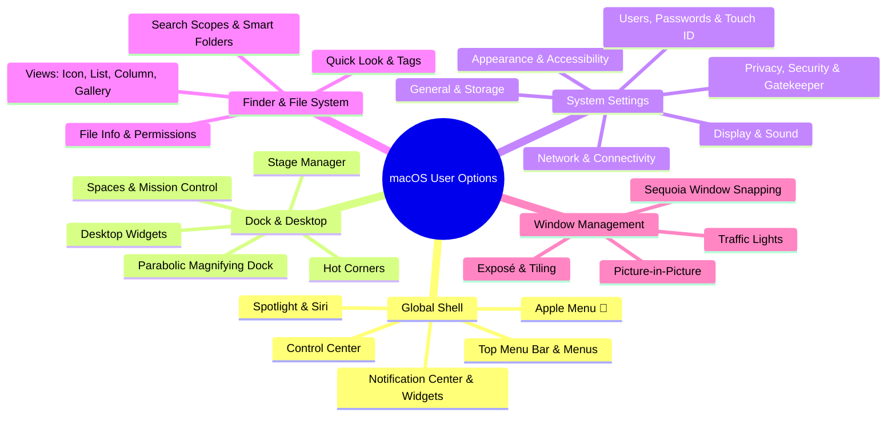

# Exhaustive Catalog of macOS User Options & AquaOS Parity Roadmap

## Goal Description

Provide a complete, structured catalog of **every option, preference pane, menu control, and customization setting that macOS (Sonoma & Sequoia)** exposes to an end-user. Simultaneously, map each capability against **AquaOS-Beta** to serve as the definitive specification and implementation plan for building a 100% faithful, macOS-grade experience on top of our immutable Linux, Wayland, and Python architecture.

---

## User Review Required

> [!IMPORTANT]
> macOS exposes over **250+ distinct user-configurable toggles, sliders, and preference panes** across its desktop shell and `System Settings`. In AquaOS, these options map to our underlying Linux stack:
> - **Display & Appearance** → Wayland (`labwc`/`wlroots`), GTK4 Layer Shell, and CSS frosted glass themes.
> - **System Controls (Volume, Brightness, Wi-Fi, Bluetooth)** → PipeWire/WirePlumber (`wpctl`), `brightnessctl`, NetworkManager (`nmcli`), and BlueZ (`bluetoothctl`).
> - **Security & Privacy (TCC & Gatekeeper)** → `aqua-shield`, Bubblewrap (`bwrap`), Linux namespaces, and file integrity scanning (`gatekeeper.py`).
> - **Intelligence & Search** → `aqua-ai` (local Ollama/llama.cpp) and `aqua-spotlight`.

Review the categorized catalog below and determine whether your immediate priority for implementation is:
1. Expanding **System Settings** in [aqua-desktop/ui/desktop.html](file:///c:/Users/iamni/Desktop/AquaOS-Beta/aqua-desktop/ui/desktop.html) to include additional preference tabs.
2. Expanding the **Global Top Menu Bar** and **Control Center** controls.
3. Adding **Finder View Options** (List, Columns, Gallery views and sorting).

---

## Complete Catalog of macOS Options Provided to a User



---

### 1. Global Menu Bar & System Menu Options

macOS provides a fixed 28px global menu bar at the top of the display containing:

| Category | Menu / Item | Options Provided to the User | AquaOS Status |
| :--- | :--- | :--- | :--- |
| **Apple Menu ()** | System Commands | - **About This Mac**: Hardware specs, macOS version, serial number, storage link.<br>- **System Settings...** (<kbd>⌘,</kbd>): Open centralized settings.<br>- **App Store...**: Open package/app repository.<br>- **Recent Items**: Sub-menu of last 10 Apps, Documents, and Connected Servers with "Clear Menu".<br>- **Force Quit...** (<kbd>⌥⌘⎋</kbd>): List unresponsive processes with instant kill.<br>- **Sleep / Restart / Shut Down**: Power state triggers with 60s countdown.<br>- **Lock Screen** (<kbd>⌃⌘Q</kbd>): Instant lock without ending session.<br>- **Log Out User...** (<kbd>⇧⌘Q</kbd>): Option to reopen windows upon next login. | **Implemented in AquaOS** ([desktop.html:L704-L717](file:///c:/Users/iamni/Desktop/AquaOS-Beta/aqua-desktop/ui/desktop.html#L704-L717)) with real process/about integration. |
| **Active Application Menus** | App Name | - **About [App]**, **Preferences / Settings** (<kbd>⌘,</kbd>).<br>- **Services**: System-wide text/file transformation hooks.<br>- **Hide [App]** (<kbd>⌘H</kbd>), **Hide Others** (<kbd>⌥⌘H</kbd>), **Show All**.<br>- **Quit [App]** (<kbd>⌘Q</kbd>). | Active app tracking implemented. |
| **Standard Menus** | File, Edit, View, Go, Window, Help | - **File**: New Window (<kbd>⌘N</kbd>), Open (<kbd>⌘O</kbd>), Save (<kbd>⌘S</kbd>), Duplicate, Rename, Move To, Quick Look (<kbd>Space</kbd>).<br>- **Edit**: Undo (<kbd>⌘Z</kbd>), Redo (<kbd>⇧⌘Z</kbd>), Cut (<kbd>⌘X</kbd>), Copy (<kbd>⌘C</kbd>), Paste (<kbd>⌘V</kbd>), Select All (<kbd>⌘A</kbd>), Find (<kbd>⌘F</kbd>), Emoji & Symbols (<kbd>⌃⌘Space</kbd>).<br>- **View**: As Icons (<kbd>⌘1</kbd>), List (<kbd>⌘2</kbd>), Columns (<kbd>⌘3</kbd>), Gallery (<kbd>⌘4</kbd>), Show Path Bar, Status Bar, Sidebar, Preview.<br>- **Go**: Back (<kbd>⌘[</kbd>), Forward (<kbd>⌘]</kbd>), Enclosing Folder (<kbd>⌘↑</kbd>), Home (<kbd>⇧⌘H</kbd>), Applications (<kbd>⇧⌘A</kbd>), Utilities (<kbd>⇧⌘U</kbd>), Go to Folder (<kbd>⇧⌘G</kbd>), Connect to Server (<kbd>⌘K</kbd>).<br>- **Window**: Minimize (<kbd>⌘M</kbd>), Zoom, Tile Left/Right, Move to Display. | Top menubar dropdowns implemented with keyboard shortcut badges. |
| **Status Menu Extras (Right Side)** | Control Center & Indicators | - **Wi-Fi**: SSID selector, connect/disconnect, Wi-Fi Settings shortcut.<br>- **Bluetooth**: Paired peripherals battery levels, connect toggle.<br>- **Battery**: Percentage toggle, power mode (Low Power vs High Performance), battery health.<br>- **Sound**: Output audio device picker, volume slider.<br>- **Display**: Brightness slider, Dark Mode toggle, Night Shift, True Tone, AirPlay mirroring.<br>- **Keyboard / Input**: Input method switcher (US, International, Dvorak).<br>- **Spotlight**: Universal search trigger (<kbd>⌘Space</kbd>).<br>- **Siri / Apple Intelligence**: Voice & text AI prompt invocation.<br>- **Clock / Date**: Analog/digital format, notification center toggle. | **Implemented in AquaOS**: Audio, Wi-Fi, Neural Boost pill, Shield pill, Live clock, Control Center. |

---

### 2. Parabolic Application Dock & Desktop Options

The Dock provides application launching, running process feedback, and file management:

| Option / Setting | Description & User Choices | AquaOS Parity Status |
| :--- | :--- | :--- |
| **Dock Position** | Pin dock to **Bottom**, **Left**, or **Right** edge of the monitor. | Bottom currently styled; dynamic edge anchoring planned. |
| **Magnification & Size** | Smooth parabolic hover magnification with adjustable zoom ratio and base icon size (16px to 128px). | **Fully Implemented**: Cosine-squared magnification physics. |
| **Minimization Effects** | Choose between **Genie Effect** (fluid warping) and **Scale Effect** (simple shrink). | Scale transition active in CSS. |
| **Auto-Hide** | Automatically slide Dock offscreen until pointer touches monitor edge. | Configurable via CSS/Settings. |
| **Indicators & Recents** | - "Show indicator lights for open applications" (little dots underneath icons).<br>- "Show recent applications in Dock" (isolated separator on right for unpinned running apps). | **Implemented**: Active glowing dots under running processes. |
| **Stacks & Trash** | - Right-side folder stacks (Fan, Grid, List views).<br>- Trash can with drag-to-delete, right-click "Empty Trash", and auto-ejection for mounted drives. | Trash icon and file deletion handlers active. |
| **Desktop Stacks & Icons** | - "Use Stacks" to auto-group files by Kind, Date Last Opened, Date Added, Date Modified, Date Created, or Tags.<br>- Icon Grid spacing, size, and label positioning (bottom vs right). | Planned for AquaOS desktop canvas. |

---

### 3. All System Settings Panes & Configurable Controls

macOS organizes all operating system configuration under **System Settings**:

#### A. Connectivity & Network
1. **Wi-Fi**:
   - Turn Wi-Fi On/Off, join 2.4/5/6 GHz networks with WPA2/WPA3.
   - Known Networks management (Auto-Join toggle, Auto-Login, Forget Network).
   - Private Wi-Fi Address (Rotating MAC address for tracking prevention).
   - Advanced TCP/IP (DHCP, Manual IP, Subnet Mask, Router), DNS servers, Proxies (HTTP, HTTPS, SOCKS), Hardware MTU.
2. **Bluetooth**:
   - Device discovery, pairing, battery telemetry, disconnect, rename device.
3. **Network & Firewall**:
   - Priority interface order (Ethernet, Wi-Fi, Thunderbolt Bridge, iPhone USB).
   - Built-in **Application Firewall** (Enable/Disable, Stealth Mode to drop unsolicited ICMP ping requests, per-app incoming connection rules).
   - VPN profiles (IKEv2, WireGuard, IPSec) with "Connect on Demand".

#### B. Notifications, Sound & Focus
4. **Notifications**:
   - Global toggle: Allow notifications when display is sleeping or mirroring.
   - Per-app customization: Alert style (None, Banners, Alerts), Badges, Sounds, Grouping (Automatic, By App, Off).
5. **Sound**:
   - Output volume slider, balance, output device picker (Built-in, HDMI, Bluetooth, AirPlay).
   - Input volume slider, microphone picker, ambient noise reduction.
   - Alert sound selection (Basso, Blow, Bottle, Frog, Funk, Glass, Hero, Morse, Ping, Pop, Purr, Sosumi, Submarine, Tink).
   - Sound Effects: "Play sound on startup", "Play user interface sound effects", "Play feedback when volume is changed".
6. **Focus (Do Not Disturb)**:
   - Presets: Do Not Disturb, Personal, Work, Sleep.
   - Allowed / Silenced People and Allowed / Silenced Applications.
   - Schedules & Automations (Time-based, Location-based, App-launch-based).
   - Focus Filters (filter Safari tab groups, Mail accounts, Calendar visibility).

#### C. General, Storage & System Maintenance
7. **About**:
   - Machine model name, CPU architecture, unified RAM, macOS build number, display resolution, serial number.
   - Detailed System Report (full I/O hardware tree, PCI devices, USB/Thunderbolt bus).
8. **Software Update**:
   - Automatic checking, automatic download, automatic security response installation.
   - Beta updates enrollment.
9. **Storage Management**:
   - Visual color-coded disk usage (macOS, Applications, Documents, Developer data, System Data, Trash).
   - Recommendations: Empty Trash automatically after 30 days, Optimize Storage, Review Large Files.
10. **AirDrop & Handoff**:
    - AirDrop visibility: Off, Contacts Only, Everyone for 10 minutes.
    - "Allow Handoff between this Mac and your iCloud devices".
    - "AirPlay Receiver": Allow Mac to accept video/audio streams from iPhones/iPads.
11. **Login Items & Background Tasks**:
    - List of apps launched on user login (<kbd>+</kbd> / <kbd>-</kbd> add/remove).
    - "Allow in Background": Granular toggles for system daemons and background helpers.
12. **Date & Time**:
    - "Set time and date automatically" via network time servers (NTP).
    - Time zone selection with automatic location detection.
    - 24-hour clock vs AM/PM, display seconds, flash time separators.
13. **Sharing**:
    - Screen Sharing & Remote Management (VNC).
    - File Sharing (SMB network shares, per-folder user ACL permissions).
    - Remote Login (OpenSSH server toggle with allowed users list).
    - Internet Sharing (share Wi-Fi through Ethernet or vice-versa).
14. **Time Machine**:
    - Backup disk selection (external USB/Thunderbolt drives or NAS network volumes).
    - Backup frequency: Hourly, Daily, Weekly, Manual.
    - Excluded files and folders list.

#### D. Appearance, Displays & Wallpapers
15. **Appearance**:
    - Theme modes: **Light**, **Dark**, or **Auto** (switches automatically at sunrise/sunset).
    - Accent Colors: 8 presets (Multicolor, Blue, Purple, Pink, Red, Orange, Yellow, Green, Graphite).
    - Highlight Color: Matches accent or custom RGB picker.
    - Sidebar icon size: Small, Medium, Large.
    - "Allow wallpaper tinting in windows" (subtle translucent window chroma bleeding).
    - Scroll Bar visibility: "Automatically based on mouse/trackpad", "When scrolling", or "Always".
16. **Control Center Configuration**:
    - Checkbox matrix: Show in Menu Bar, Show in Control Center, or Don't Show.
    - "Automatically hide and show the menu bar": Always, In Full Screen Only, On Desktop Only, Never.
17. **Displays**:
    - Scaled Resolutions: Larger Text (1280x800) up to More Space (1920x1200 or 4K/5K native).
    - Refresh Rate: 60Hz, 120Hz ProMotion, or custom rates.
    - Color Profiles: Display P3, sRGB IEC61966, Adobe RGB, Rec. 709.
    - **True Tone**: Dynamically adjust color temperature according to ambient room lighting.
    - **Night Shift**: Shift colors to the warmer end of the spectrum after sunset.
    - Virtual Multi-Monitor Arrangement: Drag displays to position virtual desktops and move the menu bar.
18. **Wallpaper & Screen Savers**:
    - Dynamic Wallpapers: Change lighting throughout the day (morning, noon, dusk, night).
    - Aerial Video Wallpapers: Slow-motion 4K landscape videos (Sonoma, Sequoia, California Coast, Space) that seamlessly freeze into wallpaper upon unlock.
    - Screen Saver start timer: 1 minute to Never.

#### E. Desktop, Multitasking & Stage Manager
19. **Desktop & Stage Manager**:
    - **Stage Manager**: Keep current app centered while grouping inactive apps on the left screen edge.
    - "Click wallpaper to reveal desktop": Always or Only in Stage Manager.
    - "Show Items on Desktop": On Desktop, In Stage Manager.
    - "Desktop Widgets": Show widgets, Monochromatic widget styling, Allow iPhone widgets via Continuity.
20. **Mission Control**:
    - Automatically rearrange Spaces based on most recent use.
    - When switching to an application, switch to a Space with open windows.
    - Group windows by application in Mission Control.
    - Displays have separate Spaces (independent virtual desktops per monitor).
    - **Hot Corners**: Configure top-left, top-right, bottom-left, bottom-right corners to trigger:
      - Mission Control, Application Windows, Desktop, Notification Center, Launchpad, Quick Note, Start Screen Saver, Disable Screen Saver, Put Display to Sleep, Lock Screen.

#### F. Privacy, Security & Gatekeeper
21. **Gatekeeper & App Security**:
    - "Allow applications downloaded from":
      - App Store
      - App Store and identified developers
    - Notarization & quarantine execution prompts.
22. **Privacy Permissions (Transparency, Consent & Control - TCC)**:
    - Granular user permissions toggles for:
      - Location Services, Camera, Microphone, Accessibility (UI automation), Full Disk Access, Files and Folders, Screen & System Audio Recording, Input Monitoring (keyloggers/macro tools), Bluetooth, Local Network, Automation (AppleScript).
23. **FileVault & Hardware Security**:
    - Full-disk encryption with user password or iCloud Recovery Key.
    - **Lockdown Mode**: Extreme protection profile disabling JIT compilation, sandboxing WebKit, and blocking unauthorized USB accessories.
    - Security Keys: Hardware FIDO2 / WebAuthn physical security keys.

#### G. Input Devices (Trackpad, Mouse, Keyboard)
24. **Trackpad**:
    - *Point & Click*: Tap to click, Secondary click (two-finger tap or corner), Tracking speed, Click pressure (Light, Medium, Firm), Force Click & haptic feedback.
    - *Scroll & Zoom*: Natural scrolling direction (content tracks finger movement), Pinch to zoom, Smart zoom (double tap with two fingers), Rotate.
    - *More Gestures*: Swipe between pages (two fingers), Swipe between full-screen apps (three/four fingers), Notification Center (two fingers from right edge), Mission Control (three fingers up), App Exposé (three fingers down), Show Desktop (thumb and three fingers spread).
25. **Keyboard**:
    - Key Repeat Rate slider & Delay Until Repeat slider.
    - Keyboard backlighting brightness with ambient light sensor toggle.
    - Globe / Fn key action: Change Input Source, Start Dictation, Show Emoji & Symbols, Do Nothing.
    - Modifier Keys remapping: Swap Caps Lock, Control, Option, Command.
    - Text Replacements (e.g., `omw` → `On my way!`).
    - Full Keyboard Navigation (tab through all controls on screen).

---

### 4. Finder, Filesystem & Window Management Options

macOS Finder provides a unified visual shell for files and windows:

| Feature | User Options Provided |
| :--- | :--- |
| **Views** | - **Icon View** (<kbd>⌘1</kbd>): Grid alignment, icon size (16-512px), text size, label placement (bottom/right).<br>- **List View** (<kbd>⌘2</kbd>): Column sorting (Name, Date Modified, Size, Kind), calculate all folder sizes.<br>- **Column View** (<kbd>⌘3</kbd>): Hierarchical tree navigation with instant preview column.<br>- **Gallery View** (<kbd>⌘4</kbd>): Large visual preview carousel with full EXIF metadata and quick action buttons. |
| **Quick Look (<kbd>Space</kbd>)** | Instant document, image, audio, video, 3D model, and code preview without launching an application. |
| **Tags & Color Labels** | Color coding files with 7 tags (Red, Orange, Yellow, Green, Blue, Purple, Gray) and custom label names. |
| **Window Controls (Traffic Lights)** | - **Red button**: Close window (<kbd>⌘W</kbd>).<br>- **Yellow button**: Minimize window to Dock (<kbd>⌘M</kbd>).<br>- **Green button**: Click to enter macOS Native Full Screen. Hover to reveal **Window Tiling Options**: Tile Left, Tile Right, Tile Quarter, Move to other display. |
| **macOS Sequoia Tiling** | Drag window to screen edge to tile left/right half; drag to corners to tile quadrants. |

---

## AquaOS Implementation & Parity Strategy

To achieve parity with these macOS user options, AquaOS implements them across four native Linux layers:

```mermaid
flowchart LR
    subgraph UI["AquaOS Desktop Web/GTK UI"]
        DesktopHTML["desktop.html (MenuBar, Dock, Windows)"]
        CSSVars["CSS Glass Tokens & Accent Themes"]
    end

    subgraph Backend["Python Core & IPC"]
        API["preview-aquaos.py / core/system_services.py"]
        SettingsConfig["~/.config/aquaos/settings.json"]
    end

    subgraph Linux["Immutable Host Linux Subsystem"]
        Wayland["Wayland Compositor (labwc/wlroots)"]
        Network["NetworkManager (nmcli)"]
        Audio["PipeWire / WirePlumber (wpctl)"]
        Security["Bubblewrap (bwrap) + Gatekeeper"]
    end

    UI <--> Backend
    Backend <--> Linux
```



### Proposed Action Plan for AquaOS-Beta

#### 1. System Settings Expansion (`aqua-desktop/ui/desktop.html`)
- **Appearance & Accent**: Already wired with 5 accent color pickers and dark/light mode toggle.
- **Display Brightness & Volume**: Wire the sliders in Control Center to call `/api/system/brightness` and `/api/system/volume`.
- **Wallpapers**: 4 dynamic wallpapers implemented (Sonoma Aurora, Sequoia Sunrise, Ventura Gold, Cyber Neural). Add wallpaper drag-and-drop or local file selector.
- **Dock Settings Tab**: Expose Dock magnification slider, position selector (Bottom/Left/Right), and Genie vs Scale animation selector in System Settings.

#### 2. Finder View Modes
- Currently implemented: Real Linux directory listing (`/api/fs/list`), file reading (`/api/fs/read`), writing (`/api/fs/write`), and folder creation.
- Add toggle for **List View**, **Icon Grid View**, and **Split Column View**.

#### 3. Aqua Gatekeeper & Permission Dialogs
- Static entropy and SHA-256 scanner is operational.
- Add macOS-style "App wants access to your Documents folder" consent modal using our `aqua-shield` subsystem.

---

## Verification Plan

### Automated Tests
Run the test suite to verify backend state and telemetry endpoints:
```powershell
python -m pytest tests/ -v
```

### Manual Verification
1. Open the running desktop at [http://127.0.0.1:8765/](http://127.0.0.1:8765/).
2. Click the top-left Apple menu icon () to inspect the system options.
3. Open **System Settings** and verify theme toggling, wallpapers, and accent colors.
4. Open **Control Center** in the top-right and test brightness and network controls.
5. Launch **Finder** and **Terminal** from the bottom dock to verify window management and traffic light controls.
